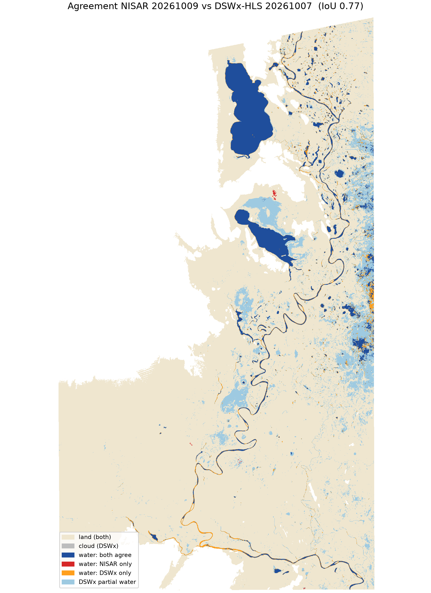
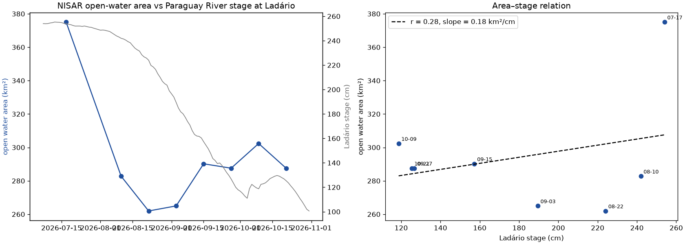

# Pantanal 2026: What NISAR Sees — and Misses — as the Water Leaves

**NASA Space Apps Challenge 2026 · Challenge: _Dancing with the SARs_**
Local event: Ciudad del Este, Paraguay · Team: Pantanal

**Interactive map and charts:** https://jpsicilia.github.io/spaceapps-2026/

**AI use:** the code and texts in this repository were written with AI assistance (Claude, Anthropic) from the author’s specifications, and reviewed and run by the author — see [`docs/ai_use.md`](docs/ai_use.md).

## Question

Where, and how much, did surface water change on the Paraguay River floodplain between July and October 2026,
and what can L-band NISAR see of it?

## Study area

Paraguay River floodplain from Corumbá / Ladário (Brazil) north to Lake Mandioré
(Brazil–Bolivia border). Bounding box (EPSG:4326):
`POLYGON((-57.95 -19.08, -57.30 -19.08, -57.30 -17.95, -57.95 -17.95, -57.95 -19.08))`

## Data

| Dataset | Use |
|---|---|
| NISAR L2 GCOV (PROVISIONAL, CRID P05023), track 132 ascending, frame 168, HH+HV, 8 dates (17 Jul → 21 Oct 2026) | Open water / flooded vegetation mapping, change, hydroperiod |
| OPERA DSWx-HLS (Version 1), 30 m | Independent optical validation (open and partial surface water) |
| Paraguay River stage at Ladário (ANA station 66825000), 15-min telemetry | Validation (daily mean) |
| JRC Global Surface Water, occurrence | Permanent-water control zone (occurrence > 90%) |
| Copernicus DEM GLO-30 | Mask of terrain above the floodplain (> 135 m); stable reference (> 200 m) |
| OpenStreetMap urban areas and buildings | Urban mask |

NISAR L2 GUNW (pair 10→22 Aug) is used only in the exploratory coherence test (`scripts/02j_coherence.py`).
Downloaded but not used in this version: Sentinel-1 RTC, NASA FIRMS.
Full inventory: [`docs/data_inventory.md`](docs/data_inventory.md)

## Method

1. `scripts/01_preprocess_gcov.py`, `02a_preprocess_all.sh`: clip each GCOV to the study area, multilook 20 → 40 m
   in linear power, Lee filter (5×5, fixed ENL), convert to dB (gamma0).
2. `02b_calibrate.py`: masks (urban, DEM > 135 m), JRC control zone, open-water thresholds
   (HV < −22 dB and HH < −16 dB, adapted from Evans (2013) and checked against the JRC zone).
3. `02d_stability.py`, `02c_timeseries.py --normalize`: per-date threshold shift from a stable reference
   (forested hills > 200 m); classification of all dates, 1 ha minimum mapping unit, area series vs Ladário,
   change map 17 Jul → 21 Oct, hydroperiod.
4. `02e_dswx_compare.py`, `02f_wind_check.py`, `02h_jul_aug_loss.py`: validation against DSWx-HLS, wind check,
   July→August loss analysis. `02g_partial_clf.py`: pre-registered partial-water classifier (negative result).
5. `02i_dswx_coverage_check.py`: per-file audit of the optical coverage used in the 2 Sep comparison.
6. `03_export_web.py`: web layers and data for the GitHub Pages site (`web/`).
   `04_build_docs.py` builds the claims register, demo slides, demo script and submission draft;
   `update_readme_results.py` writes the Results section below. All numbers come from `outputs/tables/`.

## Documentation

- [`docs/reproduce.md`](docs/reproduce.md) — environment, input data and exact run order.
- [`docs/claims.md`](docs/claims.md) — every number and claim, where it appears and its exact source.
- [`docs/demo/slides.pdf`](docs/demo/slides.pdf) and [`docs/demo/script.md`](docs/demo/script.md) — 7-slide demo.
- [`docs/submission.md`](docs/submission.md) — Space Apps project page draft.
- [`docs/ai_use.md`](docs/ai_use.md) — how AI was used.

## Repository structure

```
config/      study area, project settings, thresholds
data/        raw / external / processed (not versioned)
docs/        reproduction, claims register, demo, submission, AI use, plan, data inventory, logbook
scripts/     processing pipeline (order in docs/reproduce.md)
src/         reusable processing code (pantanal_sar)
web/         interactive web application (GitHub Pages)
outputs/     figures, maps, tables
```

## Setup

```bash
python3 -m venv .venv && source .venv/bin/activate
pip install -r requirements.txt
cp .env.example .env   # add your keys
```

NASA Earthdata credentials go in `~/.netrc` (never in this repository).

## Team

Team Pantanal (one person): José Pablo Pérez Cicilia — data processing, analysis, validation, web application, demo

## License and credits

Code: MIT.

Data:
- NISAR L2 GCOV: NASA/JPL and ISRO, distributed by the ASF DAAC (provisional products).
- OPERA. 2023. OPERA Dynamic Surface Water Extent from Harmonized Landsat Sentinel-2 (Version 1). Ver. 1.0.
  PO.DAAC, CA, USA. https://doi.org/10.5067/OPDSW-PL3V1. Contains modified Copernicus Sentinel data.
- Pekel, J.-F., Cottam, A., Gorelick, N., Belward, A. S. (2016). High-resolution mapping of global surface water
  and its long-term changes. Nature 540, 418–422. (JRC Global Surface Water)
- Copernicus DEM GLO-30: produced using Copernicus WorldDEM-30 © DLR e.V. 2010–2014 and © Airbus Defence and
  Space GmbH 2014–2018 provided under COPERNICUS by the European Union and ESA; all rights reserved.
  The organisations in charge of the Copernicus programme by law or by delegation do not incur any liability for
  any use of the Copernicus WorldDEM-30.
- Paraguay River stage at Ladário: Agência Nacional de Águas e Saneamento Básico (ANA), station 66825000.
- © OpenStreetMap contributors (ODbL).

References:
- Amani, M., Poncos, V., Brisco, B., Foroughnia, F., DeLancey, E. R., Ranjbar, S. (2021). InSAR coherence analysis for wetlands in Alberta, Canada using time-series Sentinel-1 data. Remote Sensing 13(16), 3315. https://doi.org/10.3390/rs13163315
- Brisco, B., Ahern, F., Murnaghan, K., White, L., Canisus, F., Lancaster, P. (2017). Seasonal change in wetland coherence as an aid to wetland monitoring. Remote Sensing 9(2), 158. https://doi.org/10.3390/rs9020158
- Evans, T. L. (2013). Habitat mapping of the Brazilian Pantanal using synthetic aperture radar imagery and object based image analysis. MSc thesis, Department of Geography, University of Victoria. http://hdl.handle.net/1828/4671
- Hübinger, C., Fluet-Chouinard, E., Escobar, D., Jaramillo, F. (2026). Exploring the potential of using L-band InSAR for the mapping of flooded vegetation in tropical wetlands. Remote Sensing of Environment 332, 115086. https://doi.org/10.1016/j.rse.2025.115086
- Mohammadimanesh, F., Salehi, B., Mahdianpari, M., Brisco, B., Motagh, M. (2018). Multi-temporal, multi-frequency, and multi-polarization coherence and SAR backscatter analysis of wetlands. ISPRS Journal of Photogrammetry and Remote Sensing 142, 78–93. https://doi.org/10.1016/j.isprsjprs.2018.05.009
- Touzi, R., Lopes, A., Bruniquel, J., Vachon, P. W. (1999). Coherence estimation for SAR imagery. IEEE Transactions on Geoscience and Remote Sensing 37(1), 135–149. https://doi.org/10.1109/36.739146

This project is not endorsed by NASA.

<!-- RESULTS:START -->
## Results

Study area: Paraguay River floodplain, Corumbá–Ladário to Mandioré lagoon. NISAR L2 GCOV (L-band, HH+HV), 8 acquisitions from 2026-07-17 to 2026-10-21, 40 m, Lee-filtered. Open water = HV < −22 dB and HH < −16 dB (gamma0), thresholds fixed for all dates and shifted per date by the backscatter change of a stable reference (forested hills > 200 m). Validation against OPERA DSWx-HLS (optical, independent) and the Paraguay River stage at Ladário (ANA 66825000, daily mean).

**1. NISAR maps open water reliably.** Against DSWx-HLS on near-simultaneous dates (≤ 2 days), precision is 0.92–1.00, recall 0.65–0.78 and IoU 0.62–0.78 (8 pairs). NISAR recovers on average 85% of the DSWx open-water area on common valid (clear) pixels.

**2. Open water stayed stable; the decline is in partial surface water.** On pixels valid (clear) in all paired dates (7 dates), DSWx open water went from 270 to 267 km² (r = 0.11 with Ladário stage, p = 0.81), while open + partial surface water fell from 1001 to 603 km² and tracks the river (r = 0.89, p = 0.008). Ladário fell from 253 to 124 cm. The river channel and permanent lagoons held their extent; the decline is in DSWx partial surface water, which an L-band open-water rule does not capture (NISAR open water vs stage: r = 0.25, p = 0.59). Partial surface water (DSWx-HLS class 2) is defined as “an inundated area that is at least 20% and less than 100% open water” (OPERA DSWx-HLS Product Specification, JPL D-107395 Rev B, Table 4-1): sub-pixel water such as wetlands, water with emergent vegetation or mixed shoreline pixels. Water depth is not measured.

**3. The July→August drop is not water loss.** The July→August drop in NISAR open water concentrates on DSWx partial-water pixels (×3.2 vs the plain), which DSWx still classifies as wet in August (partial→partial 42 km², open→open 36 km² of the 107 km² lost on valid (clear) pixels): consistent with vegetation emerging and raising L-band backscatter, not with water loss. About a third of the drop (36 km², 34%) falls on water that DSWx kept as open and remains unexplained. Wind is not supported: in the permanent-water zone HH changed +0.4 dB (HV +0.2 dB) after removing the stable-reference offset.

**4. Can NISAR alone see the receding partial surface water?** Not with backscatter alone (pre-registered test failed): a classifier on HH, HV and HH−HV trained on DSWx-HLS labels of 23 Aug reached a mean partial-water F1 of 0.26 on other dates (target ≥ 0.5) and its partial-water series gave r = 0.01 with Ladário (target ≥ 0.7). Next steps: texture, coherence (GUNW) and multi-date features.

**Extension (exploratory, negative).** InSAR coherence from the NISAR GUNW pair 10→22 Aug as a fourth feature, same classifier and 5 km spatial-block cross-validation on 22 Aug (DSWx-HLS 23 Aug labels), same pixels: partial-water F1 0.35 without → 0.45 with coherence (pre-registered target ≥ 0.50). Median coherence, not water / open / partial: 0.55 / 0.25 / 0.32.

Coherence has been combined with backscatter for wetland classification before (L-, C- and X-band, Newfoundland: Mohammadimanesh et al., 2018). Open water shows the lowest coherence in Sentinel-1 data over Alberta (Amani et al., 2021) and generally lacks usable coherence, while herbaceous wetlands show high but variable coherence (Brisco et al., 2017); our open-water median is also the lowest. The sample coherence magnitude is biased toward higher values (Touzi et al., 1999); open and partial water both sit at low coherence here, so this bias may narrow the gap between them (our interpretation, not tested). Combining L-band InSAR with backscatter-based methods has been suggested to improve flooded-vegetation detection with NISAR (Hübinger et al., 2026).

Limitations: the labels are DSWx-HLS “partial” surface water, an optical product, not field data; one pair (10→22 Aug) and one date; coherence depends on the temporal baseline and on vegetation phenology (Mohammadimanesh et al., 2018; Amani et al., 2021).

**Radar vs optical: every date vs most dates.** NISAR imaged at least 97.2% of the floodplain on all 8 dates, on a 12-day repeat (one 24-day gap, 17 Jul–10 Aug: cycle 026 not available). Optics covered 87–100% on 7 of 8 paired dates, but only 25% of the floodplain on 2 Sep: no HLS/DSWx product exists that day for tile 21KVV, although Sentinel-2B covered the neighbouring tiles. NISAR imaged 99.6% of it on 3 Sep.

**Caveats.** Seven to eight dates, consecutive and not independent: p-values are indicative. NISAR products are provisional (CRID P05023). Thresholds adapted from Evans (2013), who reports median L-band σ0 of ≈ −23 dB HH / −30 dB HV for brackish lakes without vegetation (salinas) and ≈ −14 dB HH / −23 dB HV for fresh-water lakes with floating or emergent vegetation (baías) (Lower Nhecolândia, ch. 2, pp. 52–53). Evans reports σ0 and our thresholds are in γ0; the γ0 − σ0 offset measured from the GCOV rtcGammaToSigmaFactor layer on 17 Jul inside the floodplain is +1.1 dB (p2–p98 +0.9 to +1.5 dB), and with it the physical check gives HH OK, HV OK. Our gamma0 HH threshold (−16 dB) lies between the two classes and our HV threshold (−22 dB) is close to the vegetated-lake value. They were checked, not tuned, against the JRC permanent-water zone. The Copernicus DEM is a surface model.

*Unverified observation:* in late September–October HH over the river (JRC permanent-water zone) drops by 1.3–2.6 dB while HV stays flat, which would be consistent with less floating vegetation in the channel.

| Figure | |
|---|---|
| Open water NISAR vs DSWx-HLS vs Ladário |  |
| Agreement map |  |
| NISAR area vs stage |  |
| Hydroperiod (dates as open water) |  |

<!-- RESULTS:END -->
