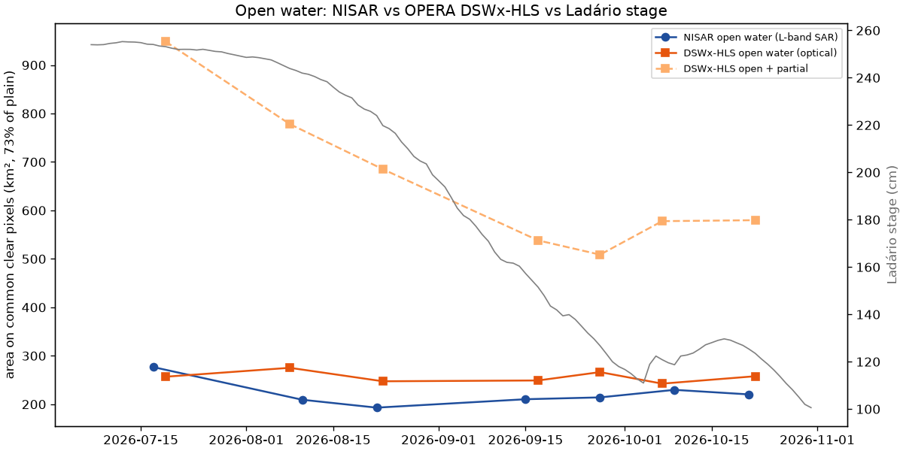

# Pantanal 2026: Water Leaving, Seen by Radar

**NASA Space Apps Challenge 2026 · Challenge: _Dancing with the SARs_**
Local event: Ciudad del Este, Paraguay · Team: _[team name]_

> 🚧 Work in progress. Project development starts on **14 Nov 2026, 09:00 (local time)**, following the hackathon rules.
> Everything in this repository before that moment is planning and setup only (folder structure, environment, documentation).

## Question

Where, and how much, did the Paraguay River floodplain dry out between July and October 2026,
which NISAR polarization shows it best, and what drove it?

## Study area

Paraguay River floodplain from Corumbá / Ladário (Brazil) north to Lake Mandioré
(Brazil–Bolivia border). Bounding box (EPSG:4326):
`POLYGON((-57.95 -19.08, -57.30 -19.08, -57.30 -17.95, -57.95 -17.95, -57.95 -19.08))`

## Data

| Dataset | Use |
|---|---|
| NISAR L2 GCOV (PROVISIONAL), track 132 ascending, frame 168, HH+HV, 8 dates (17 Jul → 21 Oct 2026) | Open water / flooded vegetation mapping, hydroperiod |
| NISAR L2 GUNW (PROVISIONAL), 7 consecutive 12-day pairs | Coherence change; water-level change under vegetation (stretch goal) |
| Sentinel-1 RTC (C-band) | L-band vs C-band comparison |
| OPERA DSWx-HLS | Independent optical validation (open water only) |
| Paraguay River stage at Ladário (ANA station 66825000) | Validation and stage–area relationship |
| NASA FIRMS active fires | Fire layer validation |
| OpenStreetMap urban boundaries | Urban mask |

Full inventory: [`docs/data_inventory.md`](docs/data_inventory.md)

## Method

_To be completed during the hackathon._ Plan: [`docs/project_plan.md`](docs/project_plan.md)

## Repository structure

```
config/      study area and project settings
data/        raw / external / interim / processed (not versioned)
docs/        plan, data inventory, decisions, logbook, references
notebooks/   exploration and figures
src/         processing code
web/         interactive web application
outputs/     figures, maps, tables
```

## Setup

```bash
python3 -m venv .venv && source .venv/bin/activate
pip install -r requirements.txt
cp .env.example .env   # add your keys
```

NASA Earthdata credentials go in `~/.netrc` (never in this repository).

## Team

- Pablo Pérez Cicilia — radar data processing, analysis, validation
- _[teammate]_ — web application, design, storytelling, video

## License

MIT. Data © NASA/JPL/ISRO (NISAR), ESA (Sentinel-1), NASA (OPERA, FIRMS), ANA (gauge data), OpenStreetMap contributors.

<!-- RESULTS:START -->
## Results

Study area: Paraguay River floodplain, Corumbá–Ladário to Mandioré lagoon. NISAR L2 GCOV (L-band, HH+HV), 8 acquisitions from 2026-07-17 to 2026-10-21, 40 m, Lee-filtered. Open water = HV < −22 dB and HH < −16 dB (gamma0), thresholds fixed for all dates and shifted per date by the backscatter change of a stable reference (forested hills > 200 m). Validation against OPERA DSWx-HLS (optical, independent) and the Paraguay River stage at Ladário (ANA 66825000, daily mean).

**1. NISAR maps open water reliably.** Against DSWx-HLS on near-simultaneous dates (≤ 2 days), precision is 0.92–1.00, recall 0.65–0.82 and IoU 0.62–0.81 (8 pairs). NISAR recovers on average 87% of the DSWx open-water area on common cloud-free pixels.

**2. Open water stayed stable; the decline is in shallow, partly vegetated water.** On pixels cloud-free in all paired dates (7 dates), DSWx open water went from 257 to 258 km² (r = 0.32 with Ladário stage, p = 0.49), while open + partial surface water fell from 948 to 580 km² and tracks the river (r = 0.90, p = 0.006). Ladário fell from 253 to 124 cm. The river channel and permanent lagoons held their extent; the decline is consistent with drying of shallow, partly vegetated water (DSWx partial class), which an L-band open-water rule does not capture (NISAR open water vs stage: r = 0.25, p = 0.58).

**3. NISAR captures shallow vegetated water while submerged and loses it as vegetation emerges.** Of the 108 km² NISAR classified as open water on 17 July but not on 10 August, 58% fall on DSWx-HLS partial surface water of 19 July (x3.3 the plain-wide share), and 23% of all NISAR open water on 17 July lies on DSWx partial water. The July→August drop is therefore a real change in surface condition (vegetation emerging from shallow water), not a hydrological loss of open water — DSWx open water did not decrease. Wind is ruled out: HH in the permanent-water zone changed only +0.4 dB (HV +0.2 dB) between 17 July and August after removing the stable-reference offset, so wind does not explain it; the drop remains unexplained. Note the 17 July NISAR scene is paired with the only Landsat-9 DSWx-HLS product (19 July); all other pairs are Sentinel-2.

**Radar sees through cloud (and likely smoke) in the fire season.** On 2026-09-02 only 25% of the floodplain was usable in DSWx-HLS; the NISAR acquisition of 2026-09-03 covered 100% of it.

**Caveats.** Seven to eight dates, consecutive and not independent: p-values are indicative. NISAR products are provisional (CRID P05023). Thresholds adapted from Evans et al. 2010 (PALSAR sigma0, converted to gamma0) and were checked, not tuned, against the JRC permanent-water zone. The Copernicus DEM is a surface model.

*Unverified observation:* in late September–October HH over the river (JRC permanent-water zone) drops by 1.3–2.6 dB while HV stays flat, which would be consistent with less floating vegetation in the channel.

| Figure | |
|---|---|
| Open water NISAR vs DSWx-HLS vs Ladário |  |
| Agreement map |  |
| NISAR area vs stage |  |
| Hydroperiod (dates as open water) |  |

<!-- RESULTS:END -->
