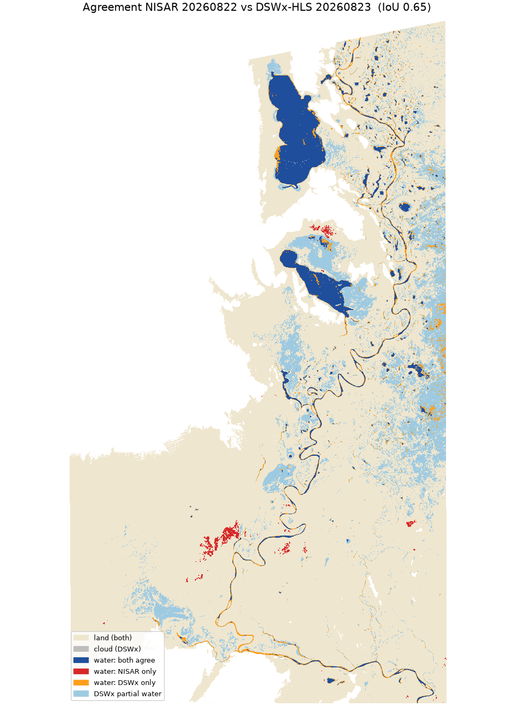
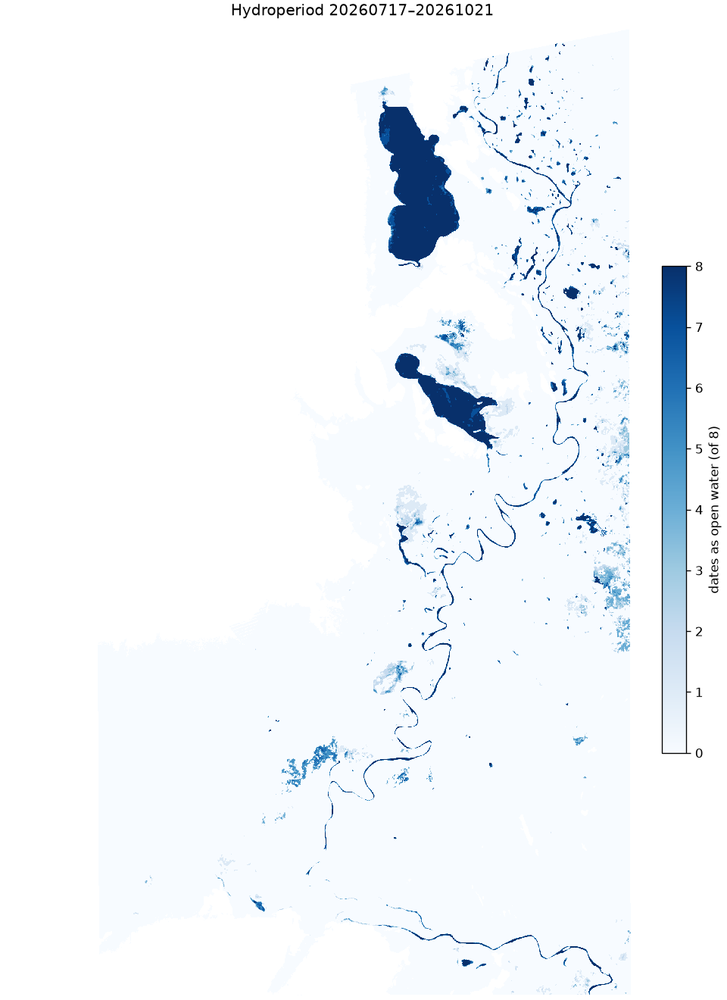

# Pantanal 2026: Water Leaving, Seen by Radar

**NASA Space Apps Challenge 2026 · Challenge: _Dancing with the SARs_**
Local event: Ciudad del Este, Paraguay · Team: Pantanal

**Interactive map and charts:** https://jpsicilia.github.io/spaceapps-2026/

## Question

Where, and how much, did surface water change on the Paraguay River floodplain between July and October 2026,
and what can L-band NISAR see of it?

## Study area

Paraguay River floodplain from Corumbá / Ladário (Brazil) north to Lake Mandioré
(Brazil–Bolivia border). Bounding box (EPSG:4326):
`POLYGON((-57.95 -19.08, -57.30 -19.08, -57.30 -17.95, -57.95 -17.95, -57.95 -19.08))`

## Data

| Dataset | Use |
|---|---|
| NISAR L2 GCOV (PROVISIONAL, CRID P05023), track 132 ascending, frame 168, HH+HV, 8 dates (17 Jul → 21 Oct 2026) | Open water / flooded vegetation mapping, change, hydroperiod |
| OPERA DSWx-HLS (Version 1), 30 m | Independent optical validation (open and partial surface water) |
| Paraguay River stage at Ladário (ANA station 66825000), 15-min telemetry | Validation (daily mean) |
| JRC Global Surface Water, occurrence | Permanent-water control zone (occurrence > 90%) |
| Copernicus DEM GLO-30 | Mask of terrain above the floodplain (> 135 m); stable reference (> 200 m) |
| OpenStreetMap urban areas and buildings | Urban mask |

Downloaded but not used in this version: NISAR L2 GUNW, Sentinel-1 RTC, NASA FIRMS.
Full inventory: [`docs/data_inventory.md`](docs/data_inventory.md)

## Method

1. `scripts/01_preprocess_gcov.py`, `02a_preprocess_all.sh`: clip each GCOV to the study area, multilook 20 → 40 m
   in linear power, Lee filter (5×5, fixed ENL), convert to dB (gamma0).
2. `02b_calibrate.py`: masks (urban, DEM > 135 m), JRC control zone, open-water thresholds
   (HV < −22 dB and HH < −16 dB, adapted from Evans et al. 2010 and checked against the JRC zone).
3. `02d_stability.py`, `02c_timeseries.py --normalize`: per-date threshold shift from a stable reference
   (forested hills > 200 m); classification of all dates, 1 ha minimum mapping unit, area series vs Ladário,
   change map 17 Jul → 21 Oct, hydroperiod.
4. `02e_dswx_compare.py`, `02f_wind_check.py`, `02h_jul_aug_loss.py`: validation against DSWx-HLS, wind check,
   July→August loss analysis. `02g_partial_clf.py`: pre-registered partial-water classifier (negative result).
5. `03_export_web.py`: web layers and data for the GitHub Pages site (`web/`).
   `update_readme_results.py` writes the Results section below from the output tables.

## Repository structure

```
config/      study area, project settings, thresholds
data/        raw / external / processed (not versioned)
docs/        plan, data inventory, decisions, logbook, references
scripts/     processing pipeline (run in numeric order)
src/         reusable processing code (pantanal_sar)
web/         interactive web application (GitHub Pages)
outputs/     figures, maps, tables
```

## Setup

```bash
python3 -m venv .venv && source .venv/bin/activate
pip install -r requirements.txt
cp .env.example .env   # add your keys
```

NASA Earthdata credentials go in `~/.netrc` (never in this repository).

## Team

Team Pantanal (one person): José Pablo Pérez Cicilia — data processing, analysis, validation, web application, demo

## License and credits

Code: MIT.

Data:
- NISAR L2 GCOV: NASA/JPL and ISRO, distributed by the ASF DAAC (provisional products).
- OPERA. 2023. OPERA Dynamic Surface Water Extent from Harmonized Landsat Sentinel-2 (Version 1). Ver. 1.0.
  PO.DAAC, CA, USA. https://doi.org/10.5067/OPDSW-PL3V1. Contains modified Copernicus Sentinel data.
- Pekel, J.-F., Cottam, A., Gorelick, N., Belward, A. S. (2016). High-resolution mapping of global surface water
  and its long-term changes. Nature 540, 418–422. (JRC Global Surface Water)
- Copernicus DEM GLO-30: produced using Copernicus WorldDEM-30 © DLR e.V. 2010–2014 and © Airbus Defence and
  Space GmbH 2014–2018 provided under COPERNICUS by the European Union and ESA; all rights reserved.
- Paraguay River stage at Ladário: Agência Nacional de Águas e Saneamento Básico (ANA), station 66825000.
- © OpenStreetMap contributors (ODbL).

This project is not endorsed by NASA.

<!-- RESULTS:START -->
## Results

Study area: Paraguay River floodplain, Corumbá–Ladário to Mandioré lagoon. NISAR L2 GCOV (L-band, HH+HV), 8 acquisitions from 2026-07-17 to 2026-10-21, 40 m, Lee-filtered. Open water = HV < −22 dB and HH < −16 dB (gamma0), thresholds fixed for all dates and shifted per date by the backscatter change of a stable reference (forested hills > 200 m). Validation against OPERA DSWx-HLS (optical, independent) and the Paraguay River stage at Ladário (ANA 66825000, daily mean).

**1. NISAR maps open water reliably.** Against DSWx-HLS on near-simultaneous dates (≤ 2 days), precision is 0.92–1.00, recall 0.65–0.82 and IoU 0.62–0.81 (8 pairs). NISAR recovers on average 87% of the DSWx open-water area on common cloud-free pixels.

**2. Open water stayed stable; the decline is in shallow, partly vegetated water.** On pixels cloud-free in all paired dates (7 dates), DSWx open water went from 257 to 258 km² (r = 0.32 with Ladário stage, p = 0.49), while open + partial surface water fell from 948 to 580 km² and tracks the river (r = 0.90, p = 0.006). Ladário fell from 253 to 124 cm. The river channel and permanent lagoons held their extent; the decline is consistent with drying of shallow, partly vegetated water (DSWx partial class), which an L-band open-water rule does not capture (NISAR open water vs stage: r = 0.25, p = 0.58).

**3. The July→August drop is not water loss.** The July→August drop in NISAR open water concentrates on DSWx partial-water pixels (×3.3 vs the plain), which DSWx still classifies as wet in August (partial→partial 41 km², open→open 34 km² of the 103 km² lost on cloud-free pixels): consistent with vegetation emerging over shallow water and raising L-band backscatter, not with water loss. About a third of the drop (34 km², 33%) falls on water that DSWx kept as open and remains unexplained. Wind is not supported: in the permanent-water zone HH changed +0.4 dB (HV +0.2 dB) after removing the stable-reference offset.

**4. Can NISAR alone see the receding shallow water?** Not with backscatter alone (pre-registered test failed): a classifier on HH, HV and HH−HV trained on DSWx-HLS labels of 23 Aug reached a mean partial-water F1 of 0.25 on other dates (target ≥ 0.5) and its partial-water series gave r = 0.01 with Ladário (target ≥ 0.7). Next steps: texture, coherence (GUNW) and multi-date features.

**Radar sees what optics cannot in the fire season.** On 2026-09-02 only 25% of the floodplain was usable in DSWx-HLS (0% cloud or shadow, likely including smoke; 73% not imaged by the optical satellite that day); the NISAR acquisition of 2026-09-03 covered 100% of it.

**Caveats.** Seven to eight dates, consecutive and not independent: p-values are indicative. NISAR products are provisional (CRID P05023). Thresholds adapted from Evans et al. 2010 (PALSAR sigma0, converted to gamma0) and were checked, not tuned, against the JRC permanent-water zone. The Copernicus DEM is a surface model.

*Unverified observation:* in late September–October HH over the river (JRC permanent-water zone) drops by 1.3–2.6 dB while HV stays flat, which would be consistent with less floating vegetation in the channel.

| Figure | |
|---|---|
| Open water NISAR vs DSWx-HLS vs Ladário |  |
| Agreement map |  |
| NISAR area vs stage |  |
| Hydroperiod (dates as open water) |  |

<!-- RESULTS:END -->
